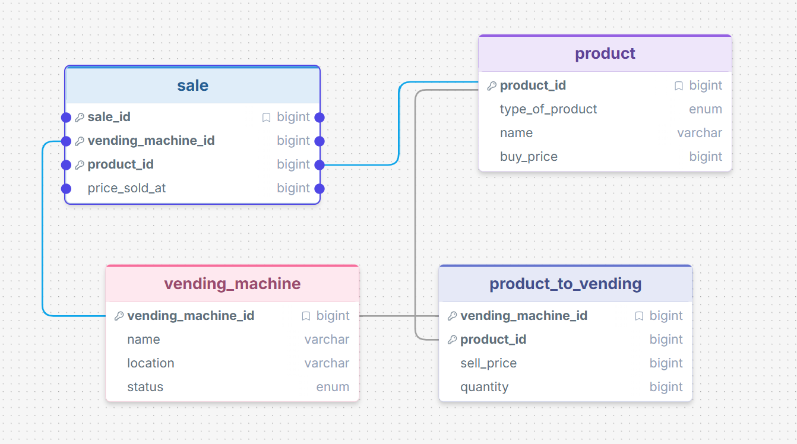

# Vending Machine AI + SQL Interface

CS 452 project. Ask questions about a vending machine business in plain English; GPT turns them into SQL, we run the SQL on SQLite, and GPT turns the result back into a plain-English answer.

## Purpose of the database

Tracks vending machines, the products they carry (with per-machine price and stock), and every sale made, so an owner can ask about profit, stock, and which machines are working.

## Schema



- `vending_machine`: name, location, and status (`active`, `out_of_service`, `maintenance`).
- `product`: type (`drink`, `snack`, `candy`, `healthy`), name, and `buy_price` (what the owner pays per unit).
- `product_to_vending`: junction table for which machine carries which product, with that machine's `sell_price` and `quantity`.
- `sale`: one row per item sold, with the price it sold at.

All prices are stored in cents.

## Setup

```bash
pip install -r requirements.txt
cp .env.example .env        # then put your own OpenAI API key in .env
python setup_db.py          # builds vending.db
python app.py               # or: python app.py --strategy few-shot
```

## How it works

1. `app.py` reads the schema (including foreign keys) and 3 sample rows per table from `vending.db`.
2. The schema and question go to `gpt-4o-mini`, which returns one SQL `SELECT` query.
3. The query runs on SQLite. Anything that is not a `SELECT` is refused.
4. The question, SQL and resulting rows go back to GPT, which writes a plain-English answer.

## Sample question that worked

**"Which machine has made the most money?"** Both strategies produced the same correct query: sum `price_sold_at` per machine, order descending, take the top row. Answer: the Engineering Machine, $22.50 (I checked this by hand against `seed.sql`).

```sql
SELECT vm.name, SUM(s.price_sold_at) / 100.0 AS total_dollars
FROM sale s JOIN vending_machine vm ON vm.vending_machine_id = s.vending_machine_id
GROUP BY vm.vending_machine_id
ORDER BY total_dollars DESC
LIMIT 1;
```

## Sample question that did not work

**"How many combos of items can you get for 5 dollars?"** (my own question). Both strategies returned the same wrong answer:

```sql
SELECT COUNT(*) FROM product_to_vending WHERE sell_price <= 500;
```

The result was 18, which is just the number of machine/product listings, because every item costs under $5. It never built any combinations. The question doesn't say how many items make a combo, whether items can repeat, or whether they must come from one machine, and the model guessed none of it. When I reworded it as "How many pairs of different items from the Library Machine cost 5 dollars or less together?", both strategies wrote a correct self-join and returned 10 (see example 7 in [examples.md](examples.md)).

Other cases that went wrong, also in [examples.md](examples.md):

- **"What's the most expensive product?"** Zero-shot returned Trail Mix at $2.25 but hid a tie with Orange Juice at $2.25. Few-shot sorted by `buy_price` and said Gatorade costs $0.90, which is what the owner pays, not what customers pay.
- **"Which machine needs restocking?"** The data has no restock threshold. Both strategies silently invented `quantity < 5`, and the English answer treated that as fact.
- **"How much profit has each product made?"** Zero-shot failed with `no such column: ptv.buy_price` because it put `buy_price` on the wrong table.

## Prompting strategies tried

Based on [Evaluating the Text-to-SQL Capabilities of Large Language Models](https://arxiv.org/abs/2305.11853).

- **Zero-shot:** schema (with foreign keys) + sample rows + question.
- **Single-domain few-shot:** same, plus three example question/SQL pairs from this database.

I ran 7 questions in each mode (see [examples.md](examples.md)). The sample is small, so treat these as impressions rather than a measurement.

| | Zero-shot | Few-shot |
|---|---|---|
| Ran without a SQL error | 6 of 7 | 7 of 7 |
| Clearly correct answer | 3 of 7 | 4 of 7 |

"Clearly correct" counts the machine-revenue, out-of-stock and reworded-pairs questions for both strategies, plus the profit question for few-shot. The vague restocking question, the most-expensive-product question and my combos question are not counted for either.

- Few-shot helped on profit per product, but that question is nearly identical to one of the few-shot examples, so the model could mostly copy it.
- Few-shot did worse on "most expensive product", where it picked `buy_price` instead of `sell_price`.
- On the rest the two strategies behaved about the same.
- A query that runs without error can still answer the wrong question. Most of the problems here were misreadings of the question or schema, not SQL syntax errors, and the examples didn't clearly fix those.

## More examples

See [examples.md](examples.md).
